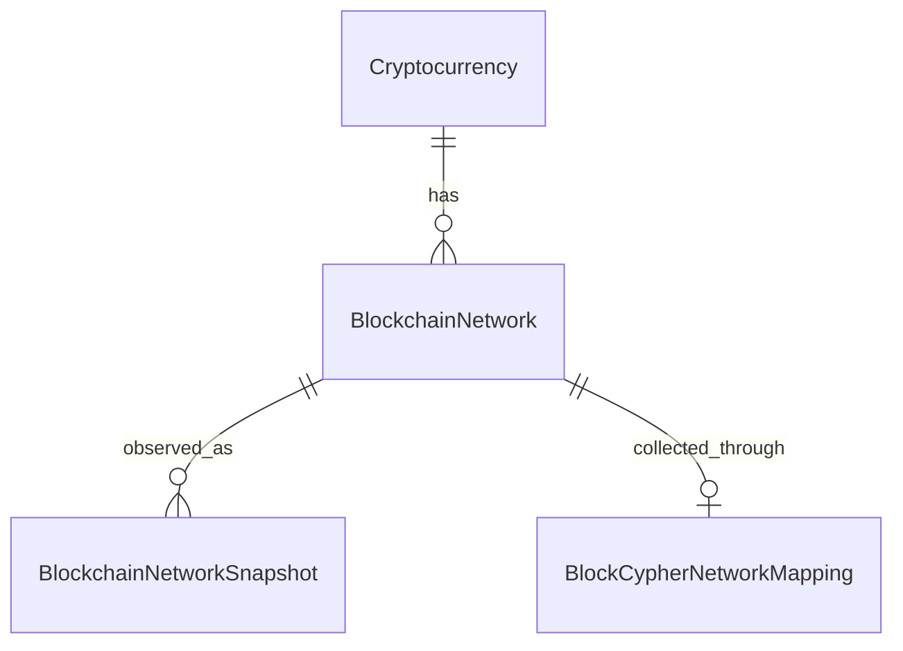

# Currency and network catalog

## Model



| Type | Meaning |
| --- | --- |
| Cryptocurrency | Entity: stable ID, unique public Code, display Name |
| BlockchainNetwork | Entity: stable ID, CryptocurrencyId, Code unique within the currency, Kind |
| NetworkKind | Enum: Mainnet = 1, Testnet = 2; multiple distinct test networks are allowed |
| BlockchainNetworkSnapshot | Entity: observation ID, BlockchainNetworkId, CreatedAt, RawResponseJson |
| BlockCypherNetworkMapping | Infrastructure configuration: network ID, provider currency code, provider network code |

The domain has no dependency on BlockCypher. Public catalog codes and provider path segments may differ.
Currency and network codes are normalized to lowercase and validated at construction. They are stable
route identifiers: do not rename them when changing a display name or provider mapping. IDs retain the
relationships; catalog codes are not duplicated in every snapshot. The repository loads catalog
references when returning snapshots, preserving the snapshot HTTP response fields. History uses page/pageSize pagination.

No Entity base class, generic catalog framework, admin API or extra deployment is introduced. Entities
carry explicit IDs and invariant-preserving constructors; equality comparisons in persistence use IDs.
CatalogCode is a shared internal validation helper, not a separate domain object for each string.

## Adding a source

Adding a currency served by the existing provider protocol requires catalog data and a mapping, not a
new handler, enum member or schema migration. The five exercise sources are migration seed data only.
Runtime code always queries the database. GET /api/chains lists catalog networks; batch and background
capture query only networks with a configured mapping. New configuration is visible on the next call
or background cycle without restarting the process.

Example for a provider-supported Dogecoin source with public network code production and provider code
main (confirm source availability before enabling collection). Run against the intended database once:

```sql
WITH currency AS (
    INSERT INTO "Cryptocurrencies" ("Id", "Code", "Name")
    VALUES (gen_random_uuid(), 'doge', 'Dogecoin')
    RETURNING "Id"
), network AS (
    INSERT INTO "BlockchainNetworks" ("Id", "CryptocurrencyId", "Code", "Kind")
    SELECT gen_random_uuid(), "Id", 'production', 1 FROM currency
    RETURNING "Id"
)
INSERT INTO "BlockCypherNetworkMappings" ("BlockchainNetworkId", "CurrencyCode", "NetworkCode")
SELECT "Id", 'doge', 'main' FROM network;
```

This is one atomic statement. Duplicate currency/network codes are rejected by unique indexes.
For an existing currency, insert a network referencing its existing ID instead of inserting the currency.
The application then exposes /api/chains/doge/production/snapshots and requests doge/main from BlockCypher.
The adapter validates the response name against DOGE.main, using the mapping rather than public codes.
Mapping segments accept only ASCII letters and digits and cannot redirect requests to another host.

If the source uses a different protocol or payload format, it still needs a suitable provider adapter.
The catalog does not make incompatible APIs interchangeable. More sources also consume more of the
existing shared quota. Task.WhenAll starts all configured captures, while the shared outbound limiter controls HTTP request rate and quota. For a much larger catalog, bounded concurrency would be needed.

## Existing data and migration

IntroduceNetworkCatalog creates the catalog and mappings, then resolves each old snapshot's Coin/Network
pair to its network ID. Only after backfilling does it enforce the foreign key and remove the old pair
columns. Snapshot IDs, request timestamps and raw payloads are untouched. An unresolved network aborts
the migration transaction. Public currency and network codes remain unchanged; the history API now uses page/pageSize pagination.

Stop old API processes before upgrading the schema because old binaries require the removed columns.
Compose recreates the API and runs the one-off migration job before starting the new application.
Keep a pre-upgrade database backup. This migration is forward-only: the old schema cannot represent an
expanded catalog, so Down deliberately refuses to discard catalog data. Rollback requires restoring a
verified backup together with the corresponding older application version.

PostgreSQL tests cover upgrading populated old tables, uniqueness, foreign keys and protected history.
An HTTP test inserts a sixth source, captures through its different provider code, includes it in batch
collection and reads its history without modifying application code or the schema.
